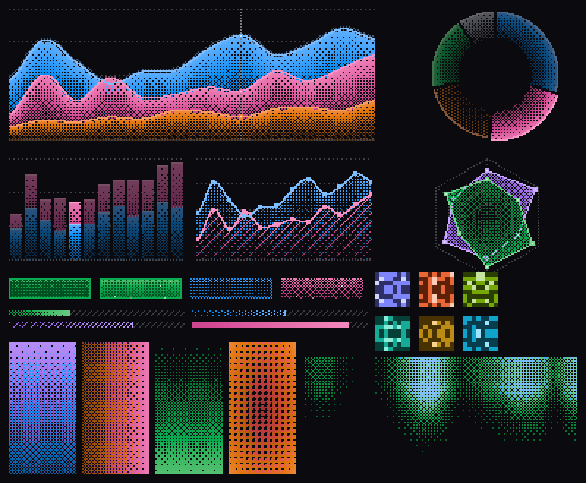

# dither-kit-rs

**Ordered-dither charts, buttons, gradients and backgrounds for Rust UIs.**
One rendering engine, three frontends: [GPUI Kit](https://gpui-kit.com) and
[Rune](https://github.com/anomalyco/rune) for native desktop apps, and
[Ratatui](https://ratatui.rs) for the terminal.

[Documentation](https://deepanshumishraa.github.io/dither-kit-rs/) ·
[GPUI gallery](crates/dither-gpui/examples/gallery.rs) ·
[Terminal gallery](crates/dither-ratatui/examples/gallery.rs) ·
[Rune gallery](crates/dither-rune/examples/gallery.rs)



<sub>The exact pixel grids both frontends paint. Regenerate with
`cargo run -p dither-core --example preview -- preview.ppm`.</sub>

---

## Why

Dithering turns smooth values into patterns of lit and unlit pixels. It is an old print and
display technique, and it gives interfaces a crisp, tactile texture that flat fills and
gradients do not have. dither-kit-rs brings the look of the React
[dither-kit](https://github.com/Boring-Software-Inc/dither-kit) to Rust, and adds terminal support.

- **One look everywhere.** Every component rasterizes into the same `PixelGrid`. A chart in a
  desktop window and the same chart in a terminal come from identical pixels.
- **Deterministic.** Ordered (Bayer) dithering is stateless per pixel. It does not flicker
  while animating and produces stable snapshots. Motion is opt-in: the `shimmer` flag makes the
  dots breathe and sparkle in every frontend.
- **Native, not a screenshot.** On GPUI, pixels are GPU quads, with horizontal runs merged. In
  the terminal they are real round image dots (kitty graphics) or braille dots. Text, axes and
  tooltips use real native text.
- **Small core.** `dither-core` has zero dependencies.

## Crates

| Crate | Purpose | Depends on |
| --- | --- | --- |
| [`dither-core`](crates/dither-core) | Dithering engine: matrices, tones, fills, and the chart, gradient, background, button, avatar and meter rasterizers | nothing |
| [`dither-gpui`](crates/dither-gpui) | GPUI Kit components | `gpui-kit =0.7.3`, `gpui-motion-kit 0.5` |
| [`dither-ratatui`](crates/dither-ratatui) | Ratatui widgets | `ratatui 0.30` |
| [`dither-rune`](crates/dither-rune) | Rune elements: meter, avatar, sparkline, gradient, background, charts | `rune` (git) |

## Components

| Component | GPUI | Ratatui | Rune | Notes |
| --- | --- | --- | --- | --- |
| Area / line / bar chart | `DitherChart` | `Chart` | `chart` + `Cartesian` | Stacking, crosshair, tooltip, clickable legend, entrance animation |
| Pie / donut | `DitherPie` | `PieChart` | `chart` + `Pie` | Hover lift, centre total, gaps between slices |
| Radar | `DitherRadar` | `RadarChart` | `chart` + `Radar` | Rings, spokes, axis labels, series selection |
| Sparkline | `DitherSparkline` | `Sparkline` | `sparkline` | Chrome-free, glows on hover |
| Button | `DitherButton` | `Button` + `ButtonState` | — | Texture thickens on hover and press; sparkles |
| Avatar | `DitherAvatar` | `Avatar` | `avatar` | 8×8 mirrored identicon from a name; about 1.5 trillion variations |
| Gradient | `DitherGradient` | `Gradient` | `gradient` | One-tone fade or two-tone blend; up, down, left, right or radial |
| Background | `DitherBackground` | `Background` | `background` + `frame` | Animated plasma, waves, ripple, noise, aurora |
| Meter | `DitherMeter` | `Meter` | `meter` | Progress bar; springs to new values on GPUI |
| Legend | `legend()` | `Legend` | — | Built into charts; also usable on its own |

The Rune helpers paint the rasterized picture; applications provide chart labels, hover
handling, legends and animation scheduling. The Notes column describes capabilities across
frontends, rather than built-in chrome in every frontend.

## Installation

```sh
# Desktop (GPUI Kit)
cargo add dither-gpui gpui-kit@=0.7.3

# Terminal (Ratatui)
cargo add dither-ratatui ratatui@0.30
```

```toml
# Desktop (Rune). Use the same pinned Rune revision for the framework and
# every patch below. These entries belong in your app workspace's root
# Cargo.toml; Cargo does not inherit patches from dependencies.
[dependencies]
dither-rune = { git = "https://github.com/DeepanshuMishraa/dither-kit-rs", package = "dither-rune" }
rune = { git = "https://github.com/anomalyco/rune", rev = "30c564251a9c0e2687720a5b12c903af04d5f2b1" }

[patch.crates-io]
winit = { git = "https://github.com/anomalyco/rune", rev = "30c564251a9c0e2687720a5b12c903af04d5f2b1" }
parley_engine = { git = "https://github.com/anomalyco/rune", rev = "30c564251a9c0e2687720a5b12c903af04d5f2b1" }
wgpu-hal = { git = "https://github.com/anomalyco/rune", rev = "30c564251a9c0e2687720a5b12c903af04d5f2b1" }
accesskit_windows = { git = "https://github.com/anomalyco/rune", rev = "30c564251a9c0e2687720a5b12c903af04d5f2b1" }
accesskit_macos = { git = "https://github.com/anomalyco/rune", rev = "30c564251a9c0e2687720a5b12c903af04d5f2b1" }
```

See Rune's ["Depending on Rune" setup notes](https://github.com/anomalyco/rune/blob/30c564251a9c0e2687720a5b12c903af04d5f2b1/crates/rune/README.md#depending-on-rune)
and [hello example](https://github.com/anomalyco/rune/tree/30c564251a9c0e2687720a5b12c903af04d5f2b1/examples/hello).
When updating Rune, check its root `Cargo.toml` and keep its listed patch crates on the same revision.
`dither-rune` is Git-only for now: Rune is not published to crates.io under its own name, and a crate
with a Git dependency cannot be published there.

The minimum supported Rust version is **1.95** for the workspace and **1.99.1** for `dither-rune`.
A plain `cargo build` at the repo root leaves `dither-rune` out; build its gallery with
`cargo run -p dither-rune --example gallery` on Rust 1.99.1 or newer. On Linux, Rune also needs
`libxkbcommon-dev` and `libwayland-dev` to build; see [Rune's platform setup notes](https://github.com/anomalyco/rune/blob/30c564251a9c0e2687720a5b12c903af04d5f2b1/crates/rune/README.md#linux).

## Agent skill

dither-kit-rs ships an [agent skill](.agents/skills/dither-kit-rs/SKILL.md) that teaches coding
agents (Claude Code, Cursor, Codex and others) the components, builders and conventions.
Install it into your project with:

```sh
npx skills add DeepanshuMishraa/dither-kit-rs
```

## Quick start: GPUI Kit

```rust
use dither_gpui::prelude::*;
use gpui_kit::*;

struct Dashboard { replay: u64 }

impl Render for Dashboard {
    fn render(&mut self, _: &mut Window, cx: &mut Context<Self>) -> impl IntoElement {
        div().p_6().gap_6().flex().flex_col()
            .child(
                DitherChart::area("visitors", vec![
                    Series::new("Desktop", Tone::Blue, vec![186., 305., 237., 73., 209., 214.]),
                    Series::new("Mobile",  Tone::Pink, vec![80., 200., 120., 190., 130., 140.])
                        .fill(Fill::Hatched),
                ])
                .labels(["Jan", "Feb", "Mar", "Apr", "May", "Jun"])
                .stacked(true)
                .bloom(Bloom::Low)
                .replay_token(self.replay),
            )
            .child(
                DitherButton::new("replay", "Replay")
                    .tone(Tone::Green)
                    .on_click(cx.listener(|this, _, _, cx| {
                        this.replay += 1;
                        cx.notify();
                    })),
            )
    }
}

fn main() {
    application().with_assets(assets::Assets).run(|cx| {
        init(cx);
        open_window(WindowOptions::default(), cx, |_, cx| cx.new(|_| Dashboard { replay: 0 }))
            .expect("open window");
    });
}
```

How the GPUI components are built:

- **State.** Components are `RenderOnce` values with an `ElementId`. Hover, selection,
  entrance progress and tooltip position are kept in keyed element state, so you only
  pass in data.
- **Motion.** Animation uses [`gpui-motion-kit`](https://github.com/1bye/gpui-motion):
  - tween entrances
  - spring button density and meter values
  - a spring tooltip that slides between data points
  - a looping clock for backgrounds and sparkles

  All of it stops when the OS asks for reduced motion.
- **Theme.** Axes, tooltips and legends use the active Kit theme tokens (`foreground`,
  `muted_foreground`, `popover`, `border`, `radius`). Light and dark both work.
- **Accessibility.** `DitherButton` wraps Kit's `Button`, which gives it focus, Tab order,
  Enter/Space activation, a button role, a focus ring and a disabled state. Legend entries
  are Kit buttons. Charts are labelled `Figure` nodes, and meters are `ProgressIndicator`
  nodes.
- **Callbacks.** `on_hover_change` and `on_selection_change` receive `&Option<usize>`, so
  they work with `cx.listener`.

## Quick start: Ratatui

```rust
use dither_ratatui::{Button, ButtonState, Chart, PieChart, prelude::*};

let series = [
    Series::new("Desktop", Tone::Blue, vec![186., 305., 237., 73., 209., 214.]),
    Series::new("Mobile", Tone::Pink, vec![80., 200., 120., 190., 130., 140.]),
];
let labels = ["Jan", "Feb", "Mar", "Apr", "May", "Jun"];

terminal.draw(|frame| {
    let chart = Chart::area(&series)
        .labels(&labels)
        .hover(app.hover)          // Option<usize>, e.g. from mouse or ←/→
        .progress(app.progress);   // 0..1, eased with dither_core::ease::out_cubic
    frame.render_widget(chart, frame.area());
})?;
```

Ratatui widgets are plain values, so the state lives in your app. These helpers turn mouse
positions into chart indexes:

| Helper | Returns |
| --- | --- |
| `Chart::index_at(area, col, row)` | Data index under the pointer |
| `Chart::legend_hit(area, col, row)` | Legend entry under the pointer |
| `PieChart::index_at(area, col, row)` | Slice under the pointer |
| `ButtonState::tick(style, dt)` | Advances the hover and press density animation |

The widgets need a **truecolor terminal**. Most modern terminals support it.

### How dots reach the terminal

`Raster` decides how dither dots become cells. `Raster::current()` picks one on first use, and
every widget takes `.raster(..)` to override it:

| Raster | Looks like | Where |
| --- | --- | --- |
| `Raster::Kitty(Kitty)` | Real anti-aliased round dots with gaps, one colour per dot, at the terminal's true pixel size | kitty, Ghostty (auto-detected; not inside tmux) |
| `Raster::Braille` | 2×4 small dots per cell, one colour per cell | Any truecolor terminal (the fallback) |
| `Raster::HalfBlock` | 1×2 square pixels per cell (`▀`) | Opt-in; the old renderer |

```rust
use dither_ratatui::{Kitty, Raster};

Raster::set_default(Raster::Braille);                              // whole app
let chart = Chart::area(&series).raster(Raster::Kitty(Kitty::new(10, 20).dots_across(3)));
```

Set `DITHER_RASTER=kitty|braille|halfblock` to force a choice without code changes. Kitty images
use [Unicode placeholders](https://sw.kovidgoyal.net/kitty/graphics-protocol/#unicode-placeholders),
so they live in normal cells: text drawn over a placeholder replaces that part of the image, and
each picture is re-sent only when it changes. Call `dither_ratatui::kitty::flush(&mut stdout)`
after every `terminal.draw(..)`. Uploads then go straight to the terminal instead of riding inside
a cell, where a tooltip or popup drawn on top could drop them.

### Animation

Every widget takes `.shimmer(true)` and `.time(seconds)`. Each lit dot breathes on its own
phase, a soft sheen sweeps across, and a few dots flash white. Shapes never move, so charts stay
readable. Redraw every frame with a running time:

```rust
Chart::area(&series).shimmer(true).time(app.start.elapsed().as_secs_f32())
```

GPUI components take `.shimmer(true)` and schedule their own frames. Shimmer pauses under the
OS reduced-motion setting. In Rune, wrap any part of a view in
`dither_rune::shimmer(frame, fps, || ...)`, and every canvas built inside it shimmers.

### Dot style (desktop)

GPUI and Rune draw square pixels by default (`DotStyle::Square`), the classic hard-edged
dither. `DotStyle::Round` draws a disc in the middle of each pixel with a gap around it, like an
LED panel or halftone print, and matches the terminal's kitty-graphics dots:

```rust
dither_gpui::set_dot_style(DotStyle::Round, cx);                  // whole GPUI app
DitherChart::area("visitors", series).dot_style(DotStyle::Round); // one component
dither_rune::dots(DotStyle::Round, || view(state, cx))            // a Rune subtree
```

## Quick start: Rune

`dither-rune` provides small functions that return Rune elements. Give each cached element a stable
key, pass a dot size in points, and provide the inputs used to rasterize it:

```rust
use dither_rune::{Cartesian, CartesianKind, Fill, Series, Tone};

let series = vec![Series::new("Desktop", Tone::Blue, vec![186., 305., 237.])];
let chart = dither_rune::chart("visitors", 3.0, "visitors-data", |w, h| {
    Cartesian::new(CartesianKind::Area, &series).render(w, h)
});

let progress = dither_rune::meter("build-progress", 3.0, 0.72, Tone::Green, Fill::Gradient);
```

The frontend also provides `avatar`, `sparkline`, `gradient` and `background`. It rasterizes the
component into a `PixelGrid` and paints horizontal runs as Rune shapes. Chart labels, legends, hit
handling and redraw scheduling stay in the application. For animated backgrounds, derive a frame
with `dither_rune::frame(time, fps)` and pass it to `background` at a modest frame rate. See the
[Rune gallery](crates/dither-rune/examples/gallery.rs) for a complete window with these helpers and
the upstream [Rune view guide](https://github.com/anomalyco/rune/blob/30c564251a9c0e2687720a5b12c903af04d5f2b1/crates/rune/README.md).

## The vocabulary

Both frontends share these types from `dither-core`:

| Type | Values |
| --- | --- |
| `Tone` | `Green` `Blue` `Purple` `Pink` `Orange` `Red` `Grey`, or `Tone::Hue(0.0..360.0)`. Each tone expands to a perceptual OKLCH ramp with `tone.shade(0.0..=1.0)`. |
| `Fill` | `Gradient` (Bayer 8×8), `Dotted`, `Hatched`, `Solid` |
| `Bloom` | `Off`, `Low`, `High`, `Aura`: a dithered glow around lit pixels |
| `Matrix` | `Bayer2`, `Bayer4`, `Bayer8`, `Halftone`, `Noise` |
| `Field` | `Plasma`, `Waves`, `Ripple`, `Noise`, `Aurora` |
| `Direction` | `Up`, `Down`, `Left`, `Right`, `Radial` |
| `ButtonStyle` | `Solid`, `Outline`, `Ghost` |

You can draw with the core directly in any renderer:

```rust
use dither_core::*;

let grid: PixelGrid = Gradient::new(Tone::Blue).to(Tone::Purple).render(64, 32);
for run in grid.runs() {
    // run.x, run.y, run.len, run.color (RGBA)
}
```

## Examples

```sh
cargo run -p dither-gpui    --example gallery   # desktop gallery
cargo run -p dither-ratatui --example gallery   # terminal gallery (mouse + keyboard)
cargo run -p dither-ratatui --example gallery -- --animate --raster braille
cargo run -p dither-rune    --example gallery   # Rune gallery (Rust 1.99.1)
cargo run -p dither-core    --example preview -- out.ppm
```

Terminal gallery keys:

| Key | Action |
| --- | --- |
| `1` `2` `3` / `Tab` | Switch page |
| `←` `→` | Move the crosshair |
| `k` | Change chart kind |
| `s` | Toggle stacking |
| `f` | Change fill |
| `b` | Change bloom |
| `r` | Replay the entrance |
| `t` | Change tone |
| `a` | Toggle shimmer |
| `g` | Cycle raster (kitty, braille, half-block) |
| `q` | Quit |

Every gallery takes `--animate` to start with the dots shimmering. The GPUI and Rune galleries
take `--round` for round dots and have a toggle for it. The terminal gallery's
`--snapshot <dir>` writes each page as a JSON cell dump, and
[`scripts/render_snapshot.py`](scripts/render_snapshot.py) turns a dump into a PNG. Kitty images
are decoded from the escape data, as a terminal would decode them.

## Platform notes

GPUI on Linux needs these development packages (Ubuntu names):

```sh
sudo apt install libfontconfig-dev libwayland-dev libxkbcommon-x11-dev \
  libx11-xcb-dev libvulkan1
```

You also need a working Vulkan driver to open windows. See the
[GPUI Kit installation guide](https://gpui-kit.com/docs/installation) for macOS and Windows.

## Development

```sh
cargo fmt --all --check
cargo clippy --workspace --all-targets -- -D warnings
cargo test --workspace   # includes dither-rune, so needs Rust 1.99.1
```

On an older toolchain, add `--exclude dither-rune` to the clippy and test commands.

`crates/dither-gpui/tests/ui.rs` runs real components in a headless Kit window. It checks:

- button clicks fire the handler
- a disabled button rejects clicks
- hovering the plot reports the right data index
- clicking legend entries selects and deselects series
- charts and meters expose the right accessibility roles and labels

Pixel screenshots in Kit tests are macOS-only, so check the desktop visuals by running the gallery.

## Architecture

```
dither-core      PixelGrid ← rasterizers (charts, gradient, background, button, avatar, meter)
   │                ↑ Matrix thresholds, Tone ramps, Fill, Bloom
   ├── dither-gpui      canvas → paint_quad per horizontal run; Kit theme, gpui-motion-kit
   ├── dither-ratatui   Raster: kitty-graphics round dots, braille 2×4, or ▀/▄ half blocks
   └── dither-rune      canvas → Shape rectangle per horizontal run; cached by size and inputs
```

## Credits

The visual language is inspired by [dither-kit](https://github.com/Boring-Software-Inc/dither-kit)
by Boring Software Inc., which builds on Evil Charts. Motion is powered by
[gpui-motion](https://github.com/1bye/gpui-motion). GPUI is by [Zed Industries](https://zed.dev),
and GPUI Kit by [Longbridge](https://github.com/longbridge/gpui-kit).

## License

Licensed under either of [Apache License, Version 2.0](LICENSE-APACHE) or [MIT license](LICENSE-MIT) at your option.
