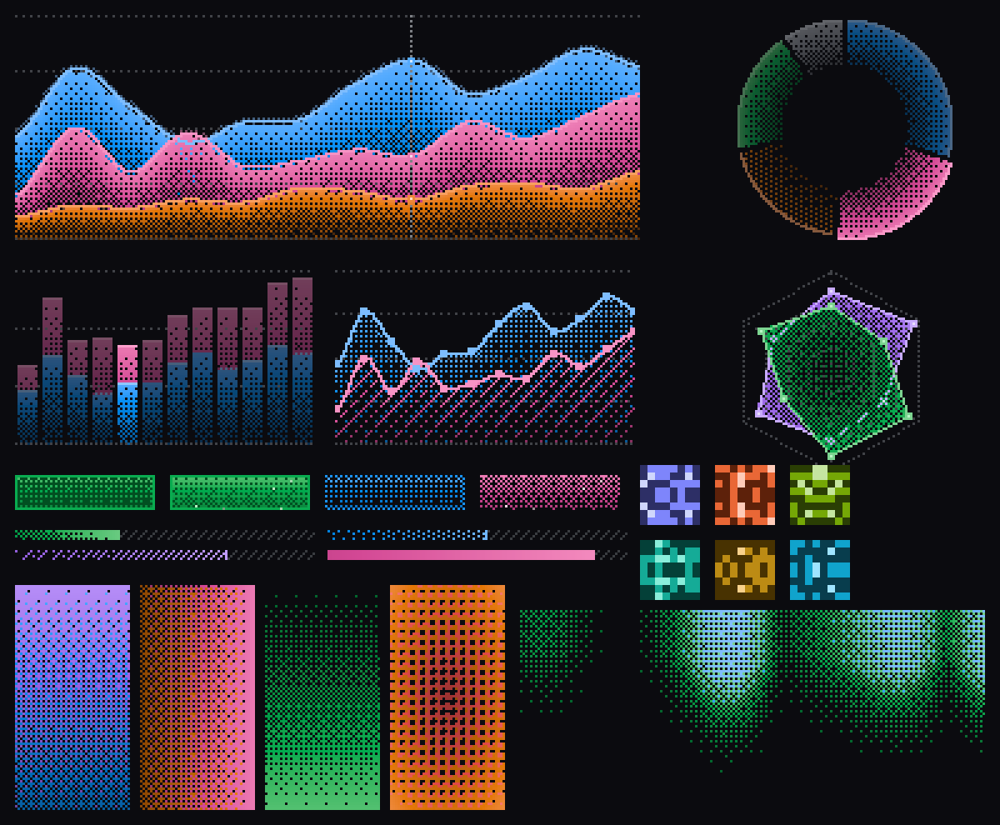

# dither-kit-rs

**Ordered-dither charts, buttons, gradients and backgrounds for Rust UIs.**
One rendering engine, two frontends: [GPUI Kit](https://gpui-kit.com) for native desktop apps and
[Ratatui](https://ratatui.rs) for the terminal.

[Documentation](https://deepanshumishraa.github.io/dither-kit-rs/) ·
[GPUI gallery](crates/dither-gpui/examples/gallery.rs) ·
[Terminal gallery](crates/dither-ratatui/examples/gallery.rs)



<sub>The exact pixel grids both frontends paint. Regenerate with
`cargo run -p dither-core --example preview -- preview.ppm`.</sub>

---

## Why

Dithering turns smooth values into patterns of lit and unlit pixels. It is an old print and
display technique, and it gives interfaces a crisp, tactile texture that flat fills and
gradients do not have. dither-kit-rs brings the look of the React
[dither-kit](https://github.com/Boring-Software-Inc/dither-kit) to Rust, and adds terminal support.

- **One look everywhere.** Every component rasterizes into the same `PixelGrid`. A chart in a
  desktop window and the same chart in a terminal come from identical pixels.
- **Deterministic.** Ordered (Bayer) dithering is stateless per pixel. It does not shimmer
  while animating and produces stable snapshots.
- **Native, not a screenshot.** On GPUI, pixels are GPU quads, with horizontal runs merged. In
  the terminal they are half-block glyphs. Text, axes and tooltips use real native text.
- **Small core.** `dither-core` has zero dependencies.

## Crates

| Crate | Purpose | Depends on |
| --- | --- | --- |
| [`dither-core`](crates/dither-core) | Dithering engine: matrices, tones, fills, and the chart, gradient, background, button, avatar and meter rasterizers | nothing |
| [`dither-gpui`](crates/dither-gpui) | GPUI Kit components | `gpui-kit =0.7.3`, `gpui-motion-kit 0.5` |
| [`dither-ratatui`](crates/dither-ratatui) | Ratatui widgets | `ratatui 0.30` |

## Components

| Component | GPUI | Ratatui | Notes |
| --- | --- | --- | --- |
| Area / line / bar chart | `DitherChart` | `Chart` | Stacking, crosshair, tooltip, clickable legend, entrance animation |
| Pie / donut | `DitherPie` | `PieChart` | Hover lift, centre total, gaps between slices |
| Radar | `DitherRadar` | `RadarChart` | Rings, spokes, axis labels, series selection |
| Sparkline | `DitherSparkline` | `Sparkline` | Chrome-free, glows on hover |
| Button | `DitherButton` | `Button` + `ButtonState` | Texture thickens on hover and press; sparkles |
| Avatar | `DitherAvatar` | `Avatar` | 8×8 mirrored identicon from a name; about 1.5 trillion variations |
| Gradient | `DitherGradient` | `Gradient` | One-tone fade or two-tone blend; up, down, left, right or radial |
| Background | `DitherBackground` | `Background` | Animated plasma, waves, ripple, noise, aurora |
| Meter | `DitherMeter` | `Meter` | Progress bar; springs to new values on GPUI |
| Legend | `legend()` | `Legend` | Built into charts; also usable on its own |

## Installation

```sh
# Desktop (GPUI Kit)
cargo add dither-gpui gpui-kit@=0.7.3

# Terminal (Ratatui)
cargo add dither-ratatui ratatui@0.30
```

The minimum supported Rust version is **1.95**, which `gpui-motion-kit` requires.

## Agent skill

dither-kit-rs ships an [agent skill](.agents/skills/dither-kit-rs/SKILL.md) that teaches coding
agents (Claude Code, Cursor, Codex and others) the components, builders and conventions.
Install it into your project with:

```sh
npx skills add DeepanshuMishraa/dither-kit-rs
```

## Quick start: GPUI Kit

```rust
use dither_gpui::prelude::*;
use gpui_kit::*;

struct Dashboard { replay: u64 }

impl Render for Dashboard {
    fn render(&mut self, _: &mut Window, cx: &mut Context<Self>) -> impl IntoElement {
        div().p_6().gap_6().flex().flex_col()
            .child(
                DitherChart::area("visitors", vec![
                    Series::new("Desktop", Tone::Blue, vec![186., 305., 237., 73., 209., 214.]),
                    Series::new("Mobile",  Tone::Pink, vec![80., 200., 120., 190., 130., 140.])
                        .fill(Fill::Hatched),
                ])
                .labels(["Jan", "Feb", "Mar", "Apr", "May", "Jun"])
                .stacked(true)
                .bloom(Bloom::Low)
                .replay_token(self.replay),
            )
            .child(
                DitherButton::new("replay", "Replay")
                    .tone(Tone::Green)
                    .on_click(cx.listener(|this, _, _, cx| {
                        this.replay += 1;
                        cx.notify();
                    })),
            )
    }
}

fn main() {
    application().with_assets(assets::Assets).run(|cx| {
        init(cx);
        open_window(WindowOptions::default(), cx, |_, cx| cx.new(|_| Dashboard { replay: 0 }))
            .expect("open window");
    });
}
```

How the GPUI components are built:

- **State.** Components are `RenderOnce` values with an `ElementId`. Hover, selection,
  entrance progress and tooltip position are kept in keyed element state, so you only
  pass in data.
- **Motion.** Animation uses [`gpui-motion-kit`](https://github.com/1bye/gpui-motion):
  - tween entrances
  - spring button density and meter values
  - a spring tooltip that slides between data points
  - a looping clock for backgrounds and sparkles

  All of it stops when the OS asks for reduced motion.
- **Theme.** Axes, tooltips and legends use the active Kit theme tokens (`foreground`,
  `muted_foreground`, `popover`, `border`, `radius`). Light and dark both work.
- **Accessibility.** `DitherButton` wraps Kit's `Button`, which gives it focus, Tab order,
  Enter/Space activation, a button role, a focus ring and a disabled state. Legend entries
  are Kit buttons. Charts are labelled `Figure` nodes, and meters are `ProgressIndicator`
  nodes.
- **Callbacks.** `on_hover_change` and `on_selection_change` receive `&Option<usize>`, so
  they work with `cx.listener`.

## Quick start: Ratatui

```rust
use dither_ratatui::{Button, ButtonState, Chart, PieChart, prelude::*};

let series = [
    Series::new("Desktop", Tone::Blue, vec![186., 305., 237., 73., 209., 214.]),
    Series::new("Mobile", Tone::Pink, vec![80., 200., 120., 190., 130., 140.]),
];
let labels = ["Jan", "Feb", "Mar", "Apr", "May", "Jun"];

terminal.draw(|frame| {
    let chart = Chart::area(&series)
        .labels(&labels)
        .hover(app.hover)          // Option<usize>, e.g. from mouse or ←/→
        .progress(app.progress);   // 0..1, eased with dither_core::ease::out_cubic
    frame.render_widget(chart, frame.area());
})?;
```

Ratatui widgets are plain values, so the state lives in your app. These helpers turn mouse
positions into chart indexes:

| Helper | Returns |
| --- | --- |
| `Chart::index_at(area, col, row)` | Data index under the pointer |
| `Chart::legend_hit(area, col, row)` | Legend entry under the pointer |
| `PieChart::index_at(area, col, row)` | Slice under the pointer |
| `ButtonState::tick(style, dt)` | Advances the hover and press density animation |

The widgets need a **truecolor terminal**. Most modern terminals support it.

## The vocabulary

Both frontends share these types from `dither-core`:

| Type | Values |
| --- | --- |
| `Tone` | `Green` `Blue` `Purple` `Pink` `Orange` `Red` `Grey`, or `Tone::Hue(0.0..360.0)`. Each tone expands to a perceptual OKLCH ramp with `tone.shade(0.0..=1.0)`. |
| `Fill` | `Gradient` (Bayer 8×8), `Dotted`, `Hatched`, `Solid` |
| `Bloom` | `Off`, `Low`, `High`, `Aura`: a dithered glow around lit pixels |
| `Matrix` | `Bayer2`, `Bayer4`, `Bayer8`, `Halftone`, `Noise` |
| `Field` | `Plasma`, `Waves`, `Ripple`, `Noise`, `Aurora` |
| `Direction` | `Up`, `Down`, `Left`, `Right`, `Radial` |
| `ButtonStyle` | `Solid`, `Outline`, `Ghost` |

You can draw with the core directly in any renderer:

```rust
use dither_core::*;

let grid: PixelGrid = Gradient::new(Tone::Blue).to(Tone::Purple).render(64, 32);
for run in grid.runs() {
    // run.x, run.y, run.len, run.color (RGBA)
}
```

## Examples

```sh
cargo run -p dither-gpui    --example gallery   # desktop gallery
cargo run -p dither-ratatui --example gallery   # terminal gallery (mouse + keyboard)
cargo run -p dither-core    --example preview -- out.ppm
```

Terminal gallery keys:

| Key | Action |
| --- | --- |
| `1` `2` `3` / `Tab` | Switch page |
| `←` `→` | Move the crosshair |
| `k` | Change chart kind |
| `s` | Toggle stacking |
| `f` | Change fill |
| `b` | Change bloom |
| `r` | Replay the entrance |
| `t` | Change tone |
| `q` | Quit |

## Platform notes

GPUI on Linux needs these development packages (Ubuntu names):

```sh
sudo apt install libfontconfig-dev libwayland-dev libxkbcommon-x11-dev \
  libx11-xcb-dev libvulkan1
```

You also need a working Vulkan driver to open windows. See the
[GPUI Kit installation guide](https://gpui-kit.com/docs/installation) for macOS and Windows.

## Development

```sh
cargo fmt --all --check
cargo clippy --workspace --all-targets -- -D warnings
cargo test --workspace
```

`crates/dither-gpui/tests/ui.rs` runs real components in a headless Kit window. It checks:

- button clicks fire the handler
- a disabled button rejects clicks
- hovering the plot reports the right data index
- clicking legend entries selects and deselects series
- charts and meters expose the right accessibility roles and labels

Pixel screenshots in Kit tests are macOS-only, so check the desktop visuals by running the gallery.

## Architecture

```
dither-core      PixelGrid ← rasterizers (charts, gradient, background, button, avatar, meter)
   │                ↑ Matrix thresholds, Tone ramps, Fill, Bloom
   ├── dither-gpui      canvas → paint_quad per horizontal run; Kit theme, gpui-motion-kit
   └── dither-ratatui   ▀/▄ half blocks, two pixels per cell; alpha blended over cell bg
```

## Credits

The visual language is inspired by [dither-kit](https://github.com/Boring-Software-Inc/dither-kit)
by Boring Software Inc., which builds on Evil Charts. Motion is powered by
[gpui-motion](https://github.com/1bye/gpui-motion). GPUI is by [Zed Industries](https://zed.dev),
and GPUI Kit by [Longbridge](https://github.com/longbridge/gpui-kit).

## License

Licensed under either of [Apache License, Version 2.0](LICENSE-APACHE) or [MIT license](LICENSE-MIT) at your option.
